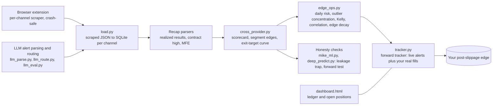

# signal-desk

A research desk for options trading signals: scrape the alerts a signal provider posts, reconstruct their realized results from their own recaps, measure the edge that survives slippage and fees, test whether outcomes are predictable at all, and then forward-test your own fills against the provider's quotes before scaling anything.

The conclusion it reached, on the providers it was pointed at: outcomes are not predictable trade by trade (forward AUC around 0.55, and a neural net only overfit). The edge, where one exists, comes from provider selection, execution and risk sizing. Providers who publish their losers can be measured; providers who publish highlight reels cannot.

## Architecture



## The forward-test loop (the point of all this)

```
python3 load.py <channel> channels/<channel>/messages.json
python3 tracker.py <channel> sync             # pull new live alerts
python3 tracker.py <channel> list             # open alerts
python3 tracker.py <channel> take <id> 1.05   # your real entry fill
python3 tracker.py <channel> close <id> 1.55  # your exit, or --pct 45
python3 tracker.py <channel> score            # your edge versus the provider's quotes
```

Run it for two to four weeks. Scale size only if the post-slippage edge is clearly positive. Account rules, position limits and daily loss limits live in `ACCOUNT_PLAN.md`.

## What each piece does

- **extension/** Chrome extension that scrapes one channel at a time and survives reloads.
- **load.py, parse_recaps.py, sulker_recaps.py** Normalize scraped messages and recover realized results from the provider's own recap posts.
- **cross_provider.py, edge_ops.py** Scorecards across providers, edge by segment and exit target, daily risk budget, Kelly sizing, correlation between providers, edge decay over time.
- **mike_ml.py, deep_predict.py, llm_eval.py** The honesty layer: can outcomes be predicted, and does the LLM parse alerts correctly. Includes the leakage trap that made an early model look better than it was.
- **tracker.py, dashboard.html** Forward tracker and ledger for live alerts and your own fills.
- **ACCOUNT_PLAN.md, COMPARISON.md** Operating rules and the provider comparison.

## Environment

Python 3.14; ML dependencies in `.venv` (numpy, scikit-learn). Market data cached in `data/` (SPY and VIX daily via Yahoo). Run the ML scripts with `.venv/bin/python`. Provider channels and personal position files under `channels/` are local data.

Personal research project. Nothing here is investment advice.
